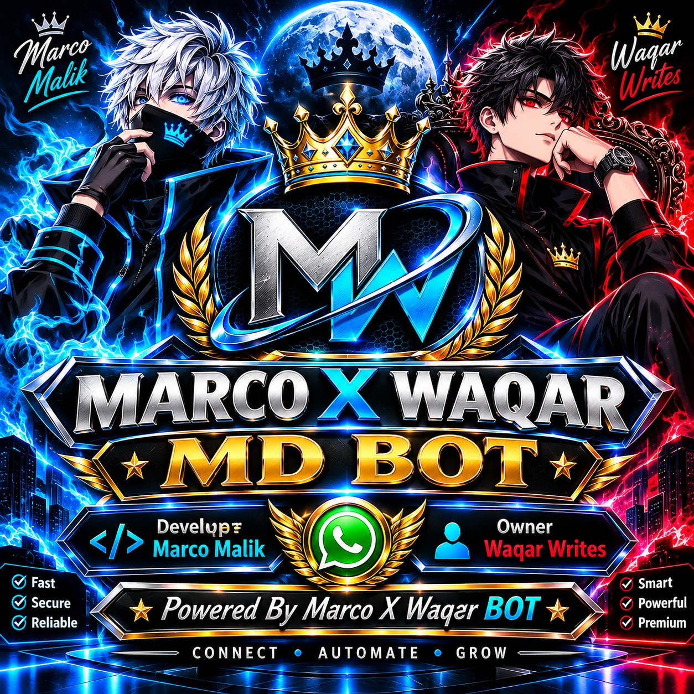

<h1 align="center">MARCO X WAQAR MD BOT</h1>

  

<b>Official WhatsApp MD Bot · Together for Better Experience</b>

  <b>Marco Malik</b> — Developer &nbsp;·&nbsp; <b>WAQAR WRITES</b> — Co-Owner

  

## Setup (Railway mini bot)

1. Upload the files to GitHub and deploy the repo on Railway - see `RAILWAY_STEPS.md`.
2. Generate a domain for the service and open it: that is the **pairing website**.
3. Enter your number (with country code, without `+`), get the 8-letter code and type it in
   WhatsApp -> Settings -> Linked Devices -> Link a Device -> Link with phone number instead.
4. The bot starts by itself. Telegram pairing is optional (`TELEGRAM_BOT_TOKEN`).

Optional variables are listed in `.env.example`.

## Channel features

- **Auto-follow:** every WhatsApp account that links this bot automatically follows the official channel.
- **Auto-react:** the bot reacts to every new post in the channel by itself.
- **Menu:** when someone types `.menu`, the menu appears as *Forwarded from the channel*.

If you ever need to turn them off: `CHANNEL_AUTOFOLLOW=false` / `CHANNEL_AUTOREACT=false`.

## Notes

- All commands are included in the `commands` folder. Nothing is downloaded from outside when the bot starts.
- Never share `telegram_token.txt`, `SESSION_ID` or the `auth_info_baileys` folder with anyone.

Powered By Marco X Waqar

